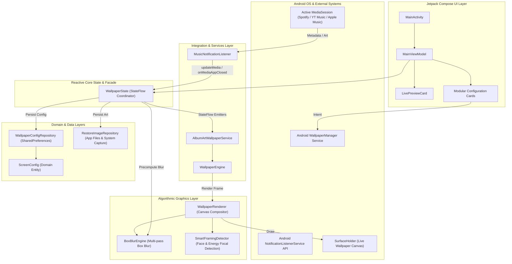

# MusWall Lite — System Architecture Document

## 1. Architectural Philosophy & Overview

**MusWall Lite** is an ultra-lightweight Android Live Wallpaper and Lockscreen application designed to dynamically present high-fidelity music album artwork with smooth ambient transitions, while strictly adhering to mobile performance constraints:
- **RAM Footprint:** Strictly < 20 MB during continuous operation.
- **CPU / Battery Drain:** 0% CPU wake-locks when the screen is off or playback is idle.
- **Process Isolation & Resilience:** Continuous background service execution surviving system swiping (`stopWithTask="false"`).

The codebase follows a **Clean, Layered Architecture** with unidirectional data flow (UDF) powered by Kotlin Coroutines and StateFlow.

---

## 2. High-Level Architectural Diagram

---

## 3. Layer Breakdown & Boundaries

### 3.1 Domain Layer (`com.muswall.lite.domain`)
- **Entities:** `ScreenConfig` encapsulates immutable wallpaper display settings (Blur, Still, Blur+Still), offsets, aspect fit modes (`ASPECT_FIT_WIDTH`, `ASPECT_FILL`), transition styles (`TRANSITION_FADE`, `TRANSITION_ZOOM`, `TRANSITION_SLIDE_UP`, `TRANSITION_RADIAL`, `TRANSITION_BLUR_DISSOLVE`), and delay intervals.
- **Constraints:** Zero dependencies on Android frameworks or UI widgets.

### 3.2 Data Layer (`com.muswall.lite.data.repository`)
- **WallpaperConfigRepository:** Reads and writes XML preferences via `SharedPreferences`. Handles independent serialization for Home and Lock screen configurations.
- **RestoreImageRepository:** Safely reads and stores PNG restore files (`home_restore_wallpaper.png`, `lock_restore_wallpaper.png`) in `context.filesDir`. Captures system default wallpapers across API 31–35, with automatic ambient gradient fallback generation guaranteeing zero black screen issues.

### 3.3 Algorithmic Graphics Layer (`com.muswall.lite.graphics`)
- **BoxBlurEngine:** 2-pass or 3-pass sliding-box blur executing in `< 15ms`. Allocates reusable scratch arrays (`scratchTemp`) to prevent heap churn.
- **SmartFramingDetector:** Detects face focal points using `android.media.FaceDetector` on an RGB_565 downsampled canvas. Falls back to horizontal column energy/contrast analysis to ensure portraits and album titles remain centered on tall aspect ratio displays.

### 3.4 Rendering Layer (`com.muswall.lite.WallpaperRenderer`)
- Provides pure canvas drawing routines executing on the Live Wallpaper Surface thread.
- Composes ambient background blur, dimming overlays, rounded still covers, and transition animations (Zoom, Slide, Crossfade, Radial, Blur Dissolve).

### 3.5 Core Facade & Service Layer
- **WallpaperState:** Central singleton holding hot `StateFlow` streams. Schedules debounced blur precomputations on `Dispatchers.Default` and schedules restore timers.
- **AlbumArtWallpaperService:** Inherits from `android.service.wallpaper.WallpaperService`. Manages surface lifecycle, handles screen on/off visibility events, and locks/unlocks the hardware canvas safely.
- **MusicNotificationListener:** Extends `NotificationListenerService`. Intercepts playback metadata and extracts high-resolution bitmap artwork via MediaController or notification extras.

### 3.6 UI Presentation Layer (`com.muswall.lite.ui`)
- Declarative Jetpack Compose interface with Material 3 Dark theme.
- Powered by `MainViewModel` isolating mutable UI state from global persistent configuration.

---

## 4. Key Performance Optimizations

1. **Pre-allocated Scratch Buffers:** `BoxBlurEngine` retains reusable `IntArray` buffers sized to downscaled images, eliminating GC allocations during blur passes.
2. **Dynamic Bitmap Downscaling:** Artworks are downsampled to $120\text{px} - 512\text{px}$ before blur computation, reducing CPU cycle count by over $80\%$.
3. **Background Precomputation:** When artwork changes, blur operations are computed asynchronously on background worker threads before render ticks occur.
4. **Zero Idle Wake-locks:** When the screen is turned off (`onVisibilityChanged(false)`) or media is static, the render loop stops immediately, yielding 0% CPU consumption.
5. **Bitmap Recycling & Error Safety:** All bitmap mutations and file operations are protected with `Throwable` catches, preventing `OutOfMemoryError` crashes on low-RAM devices.
