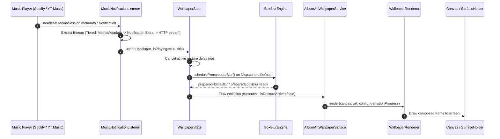
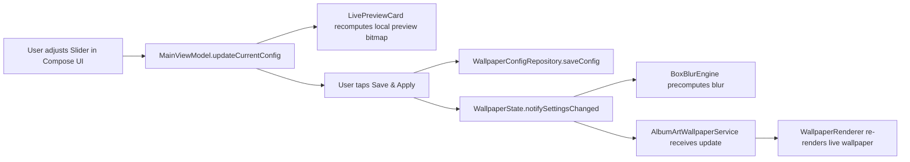
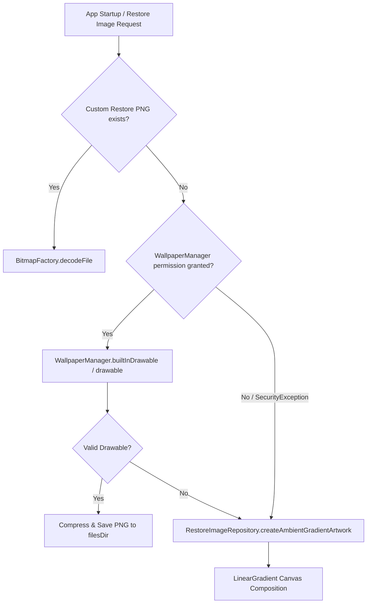

# MusWall Lite — Data Flow & State Lifecycle

## 1. Media Playback Event Lifecycle

---

## 2. Media Pause & Delay Restore Flow

When playback pauses:
1. `MusicNotificationListener` observes `PlaybackState.STATE_PAUSED` or `STATE_STOPPED`.
2. Listener invokes `WallpaperState.updateMedia(art, isPlaying=false, title)`.
3. If `config.restoreDelaySeconds == 0`, restore wallpaper is activated immediately.
4. If `config.restoreDelaySeconds > 0`, a coroutine delay job (`homeRestoreJob` / `lockRestoreJob`) is scheduled.
5. If music resumes before the delay expires, the restore job is cancelled immediately.
6. Upon delay expiration, `isHomeRestoreActive` / `isLockRestoreActive` flips to `true`, and the wallpaper smoothly transitions back to the default/restored wallpaper.

---

## 3. Media App Closed / Terminated Flow

When the user swipes away the music player:
1. `MusicNotificationListener.onNotificationRemoved()` or `onSessionDestroyed()` is triggered.
2. Listener detects zero active media sessions and calls `WallpaperState.onMediaAppClosed(context)`.
3. Any active 30s delay timers are **immediately cancelled**.
4. `currentArt` is cleared to `null` and `isHomeRestoreActive` is set to `true`.
5. `AlbumArtWallpaperService` immediately renders a smooth transition back to the default wallpaper without delay.

---

## 4. UI Configuration Flow

---

## 5. System Default Wallpaper Capture & Fallback

